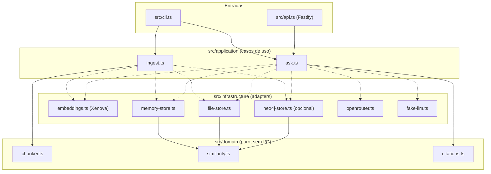

# pergunte-ao-estatuto

RAG (Retrieval-Augmented Generation) especializado em estatutos e regulamentos, com duas regras não negociáveis: **toda afirmação da resposta cita o artigo de onde veio** e o sistema **recusa responder** sempre que o documento não cobrir a pergunta — seja porque nada relevante foi encontrado, seja porque o modelo tentou citar um artigo que não estava no material recuperado. A ideia é ter um assistente de estatuto que erra para o lado seguro: prefere dizer "não encontrei base" a inventar uma resposta plausível, mas falsa.

## O que tem no projeto e quais tecnologias

| Arquivo / camada | Tecnologia | Responsabilidade |
|---|---|---|
| `src/domain/chunker.ts` | TypeScript puro | Divide o texto do estatuto em um chunk por artigo (`Art. N`), ignorando preâmbulo |
| `src/domain/similarity.ts` | TypeScript puro | Similaridade de cosseno entre embeddings |
| `src/domain/citations.ts` | TypeScript puro | Extrai citações `[Art. N]` da resposta e valida contra os artigos recuperados |
| `src/application/ingest.ts` | — | Caso de uso: chunk → embed → indexação idempotente |
| `src/application/ask.ts` | — | Caso de uso: pergunta → embed → top-4 → recusa por score baixo ou resposta com citação validada |
| `src/infrastructure/embeddings.ts` | [@xenova/transformers](https://www.npmjs.com/package/@xenova/transformers) | Embeddings locais (`Xenova/all-MiniLM-L6-v2`), sem depender de API externa |
| `src/infrastructure/memory-store.ts` | — | Vector store in-memory (usado nos testes e disponível via `VECTOR_STORE=memory`) |
| `src/infrastructure/file-store.ts` | — | Vector store persistido em JSON (padrão da CLI e da API — `ingest` e `ask` funcionam em processos separados) |
| `src/infrastructure/neo4j-store.ts` | [neo4j-driver](https://www.npmjs.com/package/neo4j-driver) | Vector store em Neo4j (opcional, via Docker) |
| `src/infrastructure/openrouter.ts` | [OpenRouter](https://openrouter.ai/) (fetch) | Geração de resposta via LLM real, atrás de uma chave de API |
| `src/infrastructure/fake-llm.ts` | — | LLM fake determinístico para demo sem chave de API |
| `src/cli.ts` | Node.js | Comandos `ingest <arquivo>` e `ask "<pergunta>"` |
| `src/api.ts` | [Fastify](https://fastify.dev/) | API HTTP: `POST /ask` |
| `tests/**` | [Vitest](https://vitest.dev/) | Testes 100% offline, com embedder e LLM fakes deterministicos |
| `docker-compose.yml` | Docker / Neo4j | Sobe um Neo4j local para o modo `VECTOR_STORE=neo4j` |
| `data/estatuto-exemplo.md` | Markdown | Estatuto **fictício** de uma associação de bairro (40 artigos) usado como corpus de exemplo |

Linguagem: TypeScript em modo `strict`, ESM nativo (`"type": "module"`), Node.js >= 20.

## Arquitetura

Clean architecture em três camadas: `domain` (regras puras, sem I/O), `application` (casos de uso, que só conhecem *ports*/interfaces) e `infrastructure` (adapters concretos — embeddings, vector stores, LLMs). Os pontos de entrada (`cli.ts` e `api.ts`) montam as dependências concretas e chamam os casos de uso.



Linhas tracejadas (`-.->`) indicam dependência via *port* (interface definida em `src/application/ports.ts`): a camada de aplicação nunca importa um adapter diretamente, apenas o tipo. Quem decide qual adapter concreto usar são `src/cli.ts` e `src/api.ts`, através de `src/infrastructure/factory.ts` (lê `VECTOR_STORE` e `LLM` do ambiente). Quando `VECTOR_STORE` não está definido, CLI e API usam o store em arquivo (`file`, índice em `.estatuto-index.json`) — assim o `ingest` feito pela CLI é enxergado tanto por `ask` na CLI quanto pelo `POST /ask` da API, em processos separados e sem Docker.

### Fluxo de `ask`

1. Embeda a pergunta com o mesmo `Embedder` usado na ingestão.
2. Recupera os 4 chunks mais similares (cosseno) no vector store.
3. Se a maior similaridade for menor que `0.35` → **recusa sem chamar o LLM** (`src/application/ask.ts`).
4. Caso contrário, monta um prompt instruindo o LLM a citar `[Art. N]` em cada afirmação e a não inventar nada, e chama o LLM.
5. Valida a resposta (`src/domain/citations.ts`): se ela não citar nenhum artigo, ou citar algum artigo fora do contexto recuperado, a resposta é descartada e vira recusa (**fail-closed**) — o texto do LLM nunca chega ao usuário sem essa validação.

## Como rodar

```bash
npm install

# 1) Demo pela CLI, sem chave de API e sem Docker.
#    A CLI persiste o índice em .estatuto-index.json (store "file" por padrão),
#    então ingest e ask funcionam em execuções/processos separados.
npm run cli -- ingest data/estatuto-exemplo.md
npm run cli -- ask "Qual é o mandato da diretoria?"

# 2) Sobe a API HTTP — ela lê o mesmo índice .estatuto-index.json gerado
#    pelo ingest da CLI acima, então já responde com base no estatuto
npm run start:api
# em outro terminal:
curl -X POST http://localhost:3000/ask \
  -H "Content-Type: application/json" \
  -d '{"question":"Qual é o mandato da diretoria?"}'
```

Saída real da demo da CLI acima (dois processos distintos, `LLM=fake`):

```text
$ npm run cli -- ingest data/estatuto-exemplo.md
Ingeridos 40 artigo(s) de "data/estatuto-exemplo.md".

$ npm run cli -- ask "Qual é o mandato da diretoria?"
De acordo com o estatuto, [Art. 21] traz a informação aplicável a essa pergunta.

Citações:
- [Art. 21] (score: 0.58)

$ npm run cli -- ask "What is the capital of France?"
Não encontrei base no documento para responder isso.
```

Para usar o LLM real (OpenRouter) em vez do fake:

```bash
export LLM=openrouter
export OPENROUTER_API_KEY=sk-...
npm run start:api
```

Para usar Neo4j em vez do store em memória:

```bash
docker compose up -d
export VECTOR_STORE=neo4j
npm run start:api
```

## Como testar

```bash
npm test           # roda a suíte Vitest inteira — 100% offline
npm run typecheck  # npx tsc --noEmit
```

Nenhum teste baixa modelo, acessa rede ou depende de Docker: `embeddings.ts` (Xenova), `openrouter.ts` e `neo4j-store.ts` têm seus módulos externos (`@xenova/transformers`, `fetch`, `neo4j-driver`) mockados nos testes, e os casos de uso (`ingest`, `ask`) são testados com um `FakeEmbedder` e um `FakeLLM` determinísticos (`tests/helpers/`).

## Variáveis de ambiente

Ver `.env.example`.

| Variável | Valores | Padrão | Descrição |
|---|---|---|---|
| `VECTOR_STORE` | `memory` \| `file` \| `neo4j` | `file` (CLI e API) | Qual vector store usar |
| `VECTOR_STORE_FILE` | caminho | `.estatuto-index.json` | Caminho do índice JSON quando `VECTOR_STORE=file` |
| `LLM` | `fake` \| `openrouter` | `fake` | Qual gerador de respostas usar |
| `OPENROUTER_API_KEY` | string | — | Obrigatória apenas quando `LLM=openrouter` |
| `OPENROUTER_MODEL` | string | `openai/gpt-4o-mini` | Modelo usado na chamada ao OpenRouter |
| `NEO4J_URI` | string | `bolt://localhost:7687` | Obrigatória apenas quando `VECTOR_STORE=neo4j` |
| `NEO4J_USER` | string | `neo4j` | — |
| `NEO4J_PASSWORD` | string | `password` | — |
| `PORT` | number | `3000` | Porta da API HTTP (`src/api.ts`) |

## Exemplo real de resposta com citação

Capturado rodando o pipeline completo de verdade (embeddings reais do `Xenova/all-MiniLM-L6-v2`, documento `data/estatuto-exemplo.md`, `LLM=fake`) contra a pergunta `"Qual é o mandato da diretoria?"`:

```json
{
  "answer": "De acordo com o estatuto, [Art. 21] traz a informação aplicável a essa pergunta.",
  "citations": [
    {
      "article": "21",
      "excerpt": "Art. 21. O mandato da Diretoria é de dois anos, permitida uma única reeleição consecutiva para o mesmo cargo.",
      "score": 0.58
    }
  ],
  "refused": false
}
```

## Exemplo real de recusa

Mesma execução, pergunta fora do escopo do documento (`"What is the capital of France?"`):

```json
{
  "answer": "Não encontrei base no documento para responder isso.",
  "citations": [],
  "refused": true
}
```

## Limitações conhecidas

Escritas de propósito aqui, sem enfeitar — é um projeto de portfólio e a honestidade sobre os limites importa mais do que parecer perfeito:

- **Calibração do threshold de recusa (0.35) com embeddings reais.** Os testes usam um `FakeEmbedder` com vetores controlados, então `0.35` funciona de forma exata e previsível neles. Com o embedder real (`Xenova/all-MiniLM-L6-v2`), medimos que frases bem formadas em português — mesmo totalmente fora do escopo do estatuto (ex.: perguntas sobre culinária ou previsão do tempo) — tendem a ter similaridade de cosseno na faixa de 0.45–0.55 com algum artigo, por causa da anisotropia natural de embeddings gerais desse porte. O guard de score rejeita com segurança perguntas sem sentido, em outro idioma ou muito curtas (validado manualmente), mas pode deixar passar para a etapa do LLM perguntas em português bem escritas porém fora de escopo. Nesse cenário, quem evita a alucinação é o guard de citação (fail-closed) combinado com um LLM real que siga a instrução do prompt de recusar quando o trecho não responde à pergunta — o que o `TemplateFakeLLM` (modo demo) não avalia, pois apenas cita mecanicamente o artigo do topo do contexto. Em produção, o `scoreThreshold` de `ask()` é um parâmetro justamente para permitir recalibrar por modelo/idioma.
- **`Neo4jVectorStore` não usa índice vetorial nativo.** Ele busca todos os nós `:Chunk` e calcula a similaridade de cosseno em memória — adequado para um único estatuto (dezenas de artigos), não para uma base grande de documentos.
- **Vulnerabilidades transitivas conhecidas em `@xenova/transformers`.** `npm audit` acusa CVEs em `protobufjs`, puxado indiretamente via `onnxruntime-web`/`onnx-proto`. É uma dependência transitiva da própria biblioteca de embeddings especificada para o projeto; não há entrada de dados não confiável passando por protobuf neste código, mas vale registrar.
- **CLI sem teste end-to-end automatizado.** Testar `src/cli.ts` de ponta a ponta exigiria rodar o `XenovaEmbedder` de verdade (download de modelo, rede) dentro da suíte, o que violaria o requisito de testes 100% offline. A lógica de seleção de adapters (`createStore`/`createLLM`) é testada isoladamente em `tests/infrastructure/factory.test.ts`, e os casos de uso que a CLI apenas orquestra (`ingest`/`ask`) têm cobertura completa.

## Origem

Este projeto foi inspirado em conceitos do curso de pós-graduação **Engenharia de Software com IA Aplicada** — a especificação (RAG com citação obrigatória e recusa por falta de base, arquitetura em portas e adapters, embeddings locais) nasceu desses estudos, mas toda a implementação neste repositório foi escrita do zero, sem consultar ou copiar código de nenhum material do curso.

## Licença

MIT — ver [LICENSE](./LICENSE).
